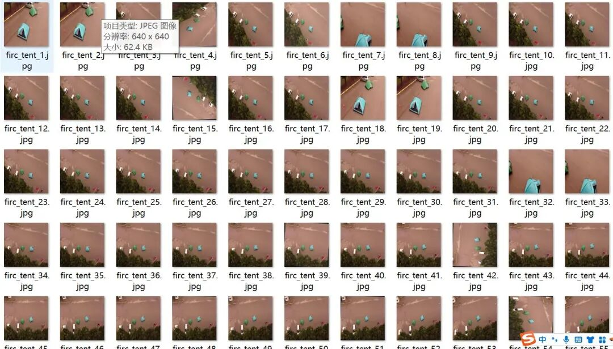
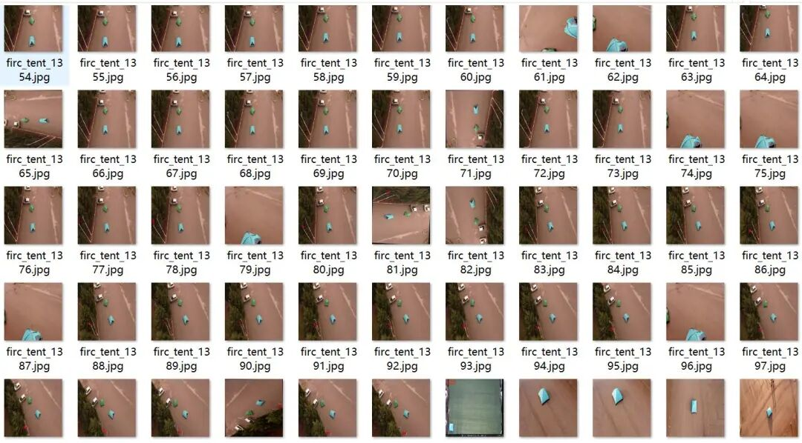
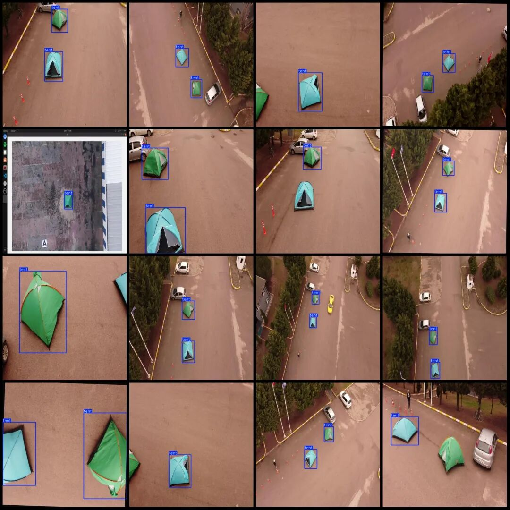

# Dataset for UAV-Viewed Camping Tent Inspection in VOC+YOLO format with 1 category, 1631 images.

The dataset was collected through simulated shooting, utilizing drones to capture two tents at different heights and angles in a single scene.

The dataset is simulated by shooting with a drone, capturing two tents at different heights and angles in one scene. Therefore, all the images are from the same scene, please carefully view the image preview.

Dataset format: Pascal VOC format + YOLO format (txt file without split path, only containing jpg images and corresponding VOC format xml files and yolo format txt files)

Number of images (number of jpg files): 1631

Number of annotations (number of xml files): 1631

Number of annotations (number of txt files): 1631

Label category count: 1

Label category name: ["tent"]

Number of boxes labeled in each category:

Tent (Camping Tent) Frame Count = 2900

Total frame count: 2900

Image resolution: 640x640

Drone: DJI Mavic Air 2

Collecting height: 5~100m

Sampling angle: 60-90°

Category: Camping Tent

Application Scenario: Used in the field of target monitoring such as security law enforcement and urban surveillance.

Using labelImg:

Annotation rules: Draw a rectangle around the category.

Important Notice: No

Special : This dataset does not guarantee the accuracy of the trained models or weight files.

Image Preview:

Annotation example:

## Payment

Here is a pay link on Stripe ( https://buy.stripe.com/3cs8yP7sY87d0vu9AB ). Please contact me lonlonago@foxmail.com after funding $89, and I will send you a complete data files , thank you!

